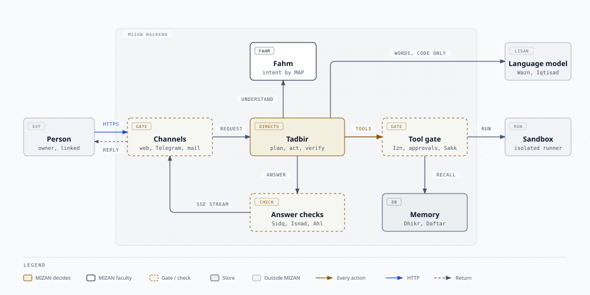
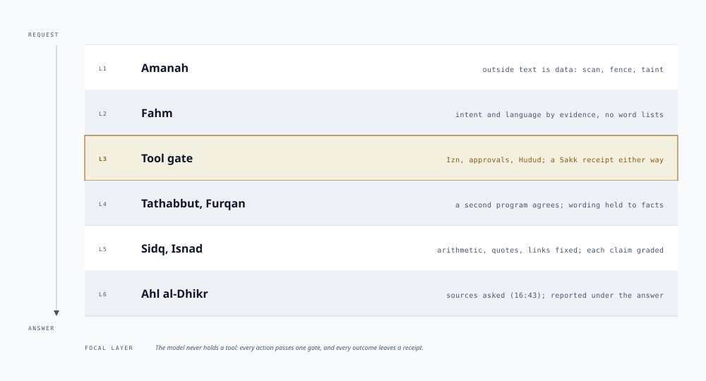
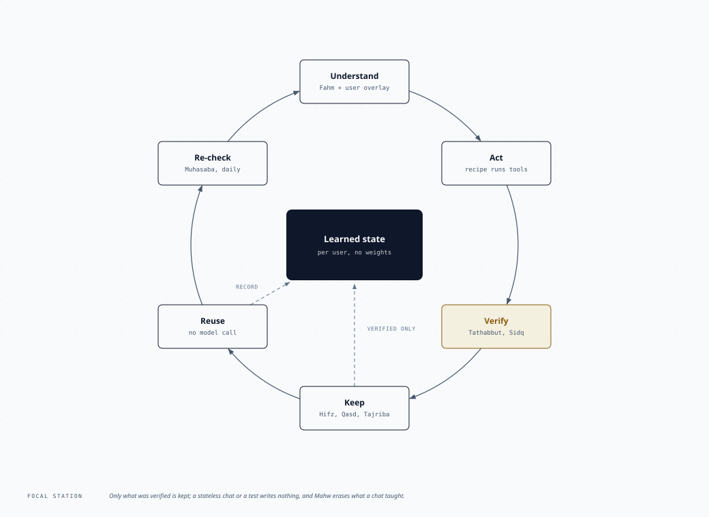

<div align="center">

# MIZAN

### A self-hosted personal AI agent whose own architecture understands, acts and verifies; the language model only speaks

**Python · FastAPI · evidence-based understanding · verified tool use · receipts for every action · Quran and hadith quoted from source**

[](https://github.com/CodeWithJuber/mizan/actions/workflows/ci.yml)
[](https://pypi.org/project/pymizan/)
[](https://www.python.org/downloads/)
[](pyproject.toml)
[](LICENSE)

[Architecture](#architecture) · [Quickstart](#quickstart) · [Features](#features) · [Reviewer quick view](#reviewer-quick-view) · [API](#api-surface) · [Docs](#documentation) · [Contributing](#contributing)

</div>

---

> **Project status:** MIZAN is an open-source **beta** (version 3.3.0 in source). Every capability below is executable code in this repository with tests; a live deployment runs it, but no enterprise production use is claimed. Measured results are in [docs/imtihan.md](docs/imtihan.md); the limits are stated next to each claim.

## Architecture

MIZAN directs, the language model speaks. A request is read by MIZAN's own understanding (**Fahm**), planned and carried out by its own orchestration (**Tadbir**), and every action passes one gate that checks permissions and writes a signed receipt. The language model (**Lisan**) is called only for language: writing a program, or wording an answer from facts MIZAN already holds. Quran and hadith text and computed results never come from the model.

<picture>
  <source media="(prefers-color-scheme: dark)" srcset="docs/diagrams/overview-dark.svg">
  
</picture>

What happens to one chat message ([`backend/agents/base.py`](backend/agents/base.py), [`backend/tadbir/engine.py`](backend/tadbir/engine.py)):

1. `POST /api/chat/stream` is authenticated before its body is read, rate-limited, and bound to the chat's approval mode. Telegram, email and WhatsApp messages from linked accounts run the same turn (`_bab_turn`).
2. `BaseAgent.execute` runs the request on its own copy of the agent. **Amanah** reads pasted text for instructions aimed at the AI and fences outside text as data.
3. **Tadbir** asks **Fahm** what is meant. Language and intent are posteriors of fitted naive Bayes models (**Tamyiz**, **Lughah**, **Qasd**); the chat's earlier messages are the prior. There are no word lists or cue regexes.
4. A recognised request is planned and executed by a MIZAN recipe: compute, run or write code, build a project, Quran, hadith, dates, web search and reading, memory, watchers, Hugging Face and more. Each tool call goes through `_execute_tool_safe` (Izn permissions, approvals, Hudud write limits) and leaves a **Sakk** receipt.
5. Results are verified before they are said. **Tathabbut** checks a program against an independent one, and **Furqan** rejects wording that adds numbers or drops a warning.
6. A request Fahm does not recognise is answered in words, with no tools. Unverified answers then pass **Sidq**, which corrects arithmetic, quotes and links, and **Isnad**, which grades each claim. **Ahl al-Dhikr** asks outside sources about factual claims and reports what it found under the answer.

<picture>
  <source media="(prefers-color-scheme: dark)" srcset="docs/diagrams/trust-layers-dark.svg">
  
</picture>

MIZAN learns only from what it verified, and changes no model weights. Learned state is kept per user and is erasable:

- Qasd and Ta'allum learn how a user phrases requests.
- Hifz keeps checked programs.
- Tajriba keeps repair lessons.
- Majlis, Tajdid and Wazn keep Beta posteriors over agents, instructions and models.
- Tadhkir sets memory strength (FSRS).

Stateless chats and evaluations write nothing. **Mahw** erases a chat everywhere, including what MIZAN learned from it.

<picture>
  <source media="(prefers-color-scheme: dark)" srcset="docs/diagrams/learning-loop-dark.svg">
  
</picture>

**Interactive diagrams.** Each one is drawn from the code: every box links to the source lines at a pinned commit. To view one, download the HTML file and open it in a browser. Sources and how to regenerate them are in [docs/diagrams](docs/diagrams/README.md).

| Diagram | Shows |
| --- | --- |
| [`runtime.html`](docs/diagrams/runtime.html) | Runtime architecture |
| [`chat-turn.html`](docs/diagrams/chat-turn.html) | One chat turn, write → run → check |
| [`learning.html`](docs/diagrams/learning.html) | Learning from verified outcomes |
| [`approval.html`](docs/diagrams/approval.html) | Approval lifecycle of a changing action |
| [`imtihan.html`](docs/diagrams/imtihan.html) | The AGI test workflow |

The full architecture write-up is [docs/architecture.md](docs/architecture.md).

## Quickstart

Released package (PyPI `pymizan` 3.1.2; the source tree is 3.3.0):

```bash
pip install pymizan
mizan setup     # configure a provider: Anthropic, OpenAI, OpenRouter or Ollama
mizan chat
```

From source, with the web app (Docker Compose):

```bash
git clone https://github.com/CodeWithJuber/mizan.git
cd mizan
cp .env.example .env    # set SECRET_KEY and one provider key
docker compose up -d --build
```

Then open `http://localhost:3100` for the web app. The API is on `http://localhost:8000`, with OpenAPI at `/api/docs`. Full setup: [Run locally](#run-locally).

## Features

**Understanding and orchestration**
- **Tadbir** ([docs/tadbir.md](docs/tadbir.md)): MIZAN plans, runs every tool and verifies. `MIZAN_ORCHESTRATION=mizan` (the default) means the model never controls a tool. **Majlis** gives each part to the best agent by Thompson sampling.
- **Fahm by evidence** ([docs/fahm.md](docs/fahm.md)): weighted naive Bayes with leave-one-out-fitted smoothing, weights and a length exponent. The decision is MAP, with "converse" as one of the classes.
- **Ta'lim** ([docs/talim.md](docs/talim.md)): administrators teach new intents or languages, typed or imported from Hugging Face. A batch is kept only when it makes no known example worse.

**Truth and provenance**
- **Quran and hadith from source** ([docs/fihris.md](docs/fihris.md), [docs/sarf.md](docs/sarf.md)):
  - finds ayahs by their words;
  - counts surahs and ayahs;
  - analyses Arabic morphology from the Quranic Arabic Corpus;
  - quotes hadith verbatim.
- **Sidq, Isnad, Ahl al-Dhikr, Nazm** ([sidq](docs/sidq.md), [isnad](docs/isnad.md), [ahl-dhikr](docs/ahl-dhikr.md), [nazm](docs/nazm.md)): correct, grade, source and shape answers. Ruling questions are referred to a qualified scholar.
- **Tathabbut, Hifz, Muhasaba** ([docs/automatic-learning.md](docs/automatic-learning.md)): independent cross-checks, reuse of checked programs, and a daily re-check of unverified answers.

**Safety and trust**
- **Approvals** ([docs/agentic-coding.md](docs/agentic-coding.md)): per-chat modes `auto`, `auto_edits`, `ask` and `plan`. Unattended runs hold their actions for the owner (see the [approval lifecycle](docs/diagrams/approval.html)).
- **Amanah** ([docs/amanah.md](docs/amanah.md)): prompt-injection containment, learned from licensed datasets.
- **Hudud** ([docs/hudud.md](docs/hudud.md)): a guard on what programs MIZAN runs may write.
- **Sakk** ([docs/sakk.md](docs/sakk.md)): hash-chained receipts and Ed25519-signed checkpoints, with a public reliability page.
- **Iqtisad** ([docs/iqtisad.md](docs/iqtisad.md)): hard per-user spending limits, admitted before each paid call.

**Memory and the user's data**
- **Daftar** ([docs/daftar.md](docs/daftar.md)): a ledger of what MIZAN keeps about a user, with provenance, export and import.
- **Mahw** ([docs/mahw.md](docs/mahw.md)): true forget, with a receipt.
- **Tadhkir** ([docs/quranic-algorithms.md](docs/quranic-algorithms.md)): FSRS memory strength.

**Work**
- **Agentic coding** ([docs/agentic-coding.md](docs/agentic-coding.md), [docs/coding-workspaces.md](docs/coding-workspaces.md)): project tools, sandboxed server sessions with previews and a terminal, and an in-browser IDE.
- **Shahid** ([docs/shahid.md](docs/shahid.md)): a sandboxed browser on the user's own sites. Every step is a receipt; submissions need approval.
- **Connectors** ([docs/connectors.md](docs/connectors.md)): MCP servers with pinned tool descriptions.
- **Agent Skills** ([docs/agent-skills.md](docs/agent-skills.md)): `SKILL.md` skills.
- **Hugging Face** ([docs/huggingface.md](docs/huggingface.md)): read on the server, never from the sandbox.

**Channels and senses**
- **Bab** ([docs/bab.md](docs/bab.md)): Telegram, email (DMARC-checked), WhatsApp Cloud API, Web Push.
- **Muraqabah** ([docs/muraqabah.md](docs/muraqabah.md)): watchers. Notices are held during salah, using locally computed prayer times.
- **Sama'** ([docs/sama.md](docs/sama.md)): speech to text on MIZAN's own server.
- **Basar** ([docs/basar.md](docs/basar.md)): images in chat, re-encoded without EXIF.

**Evaluation**
- **Imtihan** ([docs/imtihan.md](docs/imtihan.md)): 194 tasks sent to the base model alone and to MIZAN, scored by rule, with Wilson intervals. It includes:
  - agentic tasks;
  - ARC-style games;
  - a ten-faculty cognitive profile (Quwa) against a human panel.
- **Debug mode** ([docs/debug-mode.md](docs/debug-mode.md)): one message to both arms, with a full trace.

**Own models**
- **mizan.nlp** ([docs/nlp.md](docs/nlp.md)): native Qur'anic Arabic word-sense disambiguation, flag-gated.
- **Ruh** ([ruh_model/README.md](ruh_model/README.md), [docs/TRAINING.md](docs/TRAINING.md)): a root-space transformer, trained in a 4-stage curriculum.

## Reviewer quick view

This section separates what the repository demonstrates from what it does not.

### What the code demonstrates

| Area | Implementation | Evidence | Boundary |
| --- | --- | --- | --- |
| Own orchestration | Fahm understanding, Tadbir recipes, verification, Lisan for language only | [`backend/tadbir/`](backend/tadbir), [`tests/test_tadbir.py`](tests/test_tadbir.py) | A request Fahm does not recognise is answered in words with no tools; recognition is probabilistic, and its leave-one-out accuracy is in `backend/core/data/tamyiz.json` |
| Tool gate | Every tool call through `_execute_tool_safe`: Izn, approvals, Hudud, Amanah taint, Sakk receipt | [`backend/agents/base.py`](backend/agents/base.py), [`backend/security/approvals.py`](backend/security/approvals.py), [`backend/security/sakk.py`](backend/security/sakk.py) | Application controls; code runs in a separate sandbox runner that the operator must deploy |
| Truth checks | Sidq corrections, Isnad grades, Ahl al-Dhikr source checks with a multilingual NLI model | [`backend/tadbir/sidq.py`](backend/tadbir/sidq.py), [`backend/tadbir/isnad.py`](backend/tadbir/isnad.py), [`backend/tadbir/ahl_dhikr.py`](backend/tadbir/ahl_dhikr.py) | Checks what can be checked (arithmetic, quotes, links, sourced claims); model reasoning itself is graded, not proven |
| Human approval | Allow/deny/always in the live chat; held actions for unattended runs, decided once against a SHA-256 fingerprint | [`backend/security/approvals.py`](backend/security/approvals.py), `/api/chat/approvals/{id}`, `/api/chat/held/{id}` | In-process futures: run one uvicorn worker |
| Memory | SQLite memory (Dhikr), Daftar ledger, FSRS strength, Masalik pathways, knowledge graph; Chroma when `MIZAN_VECTOR_URL` is set | [`backend/memory/`](backend/memory) | Local and per-user; vector recall is optional |
| Evaluation | Imtihan suite with base-vs-MIZAN arms, rule scorers, Wilson intervals, faculty profile, human panel | [`backend/imtihan/`](backend/imtihan), [`tests/test_imtihan.py`](tests/test_imtihan.py) | The human baseline exists only once panel members answer |
| Providers | Anthropic, OpenAI, OpenRouter, Ollama, the local Ruh model | [`backend/providers.py`](backend/providers.py), [`backend/providers_ruh.py`](backend/providers_ruh.py) | Tests do not prove live calls to every provider |
| mizan.nlp | 48 per-lemma scikit-learn classifiers, 5.4 MB artifact with a validated manifest | [`nlp/`](nlp), [`nlp/artifacts/default/manifest.json`](nlp/artifacts/default/manifest.json), [`tests/test_nlp.py`](tests/test_nlp.py) | Accuracy 0.8150, macro-F1 0.6380 on a whole-surah holdout (n=627); off unless `MIZAN_NLP_NATIVE_WSD=1` |

### Test and build proof

- CI runs lint, the type check, the tests and the package and Docker builds on every pull request ([`.github/workflows/ci.yml`](.github/workflows/ci.yml)). The workflow badge is the current signal.
- At commit `5cc11dc` (28 October 2026), `pytest --collect-only` collects **2,721** backend tests; the frontend has 41 test files (`npm test`). Counts are a dated snapshot.

### Not included

- No LangGraph, LangChain, Semantic Kernel, AutoGen, CrewAI or Copilot Studio: orchestration is MIZAN's own.
- No Azure OpenAI or Azure AI Foundry provider.
- No Discord or Slack adapter: the channels API reports them, but never as connected.
- No claim of verified enterprise production use, SLOs or customer traffic.

## mizan.nlp — native Qur'anic Arabic NLP


_Recording made with an earlier artifact (v1.0.0, the one PyPI `pymizan` 3.1.2 carries): آية (sign 0.97 vs verse 0.03), نفس (soul 0.995 vs self/life), then abstaining (`[]`) on an unknown lemma. The current artifact (v1.2.1) gives the output below._

`mizan.nlp` ([`nlp/`](nlp)) is a native word-sense disambiguation module for Qur'anic Arabic: 48 per-lemma scikit-learn LogisticRegression classifiers trained on Q-CSMP v2, frozen into a 5.4 MB joblib artifact (`mizan-sense-wsd` v1.2.1) with a validated manifest.

```bash
pip install -e ".[nlp]"
python -c "
from nlp import disambiguate, is_ready
print(is_ready())  # True once the packaged artifact validates
for sense_id, conf in disambiguate('مَٰلِكِ يَوْمِ ٱلدِّينِ', 'يَوْم'):
    print(sense_id, round(conf, 4))
# qcsmp2:يَوْم:judgment-day 0.9629
# qcsmp2:يَوْم:ordinary-day 0.0371
"
```

- **Measured:** test accuracy 0.8150 against the merged 96-sense labels, macro-F1 0.6380, whole-surah holdout (n=627), preregistered before evaluation. All of it is in [`manifest.json`](nlp/artifacts/default/manifest.json).
- **Fail-closed:** with no valid artifact it raises `ModelNotReadyError`; with an unknown lemma it returns `[]`, not a guess. The lemma must appear in the text as written (one attached clitic such as و, ب or ال is allowed); another form, such as the plural آيات for آية, also returns `[]`.
- **Installed package:** PyPI `pymizan` 3.1.2 carries the earlier v1.0.0 artifact (accuracy 0.7592); v1.2.1 ships from source.
- **Trust boundary:** the manifest (schema, files, SHA-256) is validated _before_ unpickling. Artifacts load only from the packaged directory or an operator-set `MIZAN_NLP_ARTIFACT`.
- **Decisions on record:** [`nlp/artifacts/DECISIONS.md`](nlp/artifacts/DECISIONS.md).

Four integration points are wired behind `MIZAN_NLP_NATIVE_WSD=1` (default off; off leaves behaviour unchanged):

| # | Where | What the loop gets |
| --- | --- | --- |
| IP-1 | `think()` in `backend/agents/base.py` | `[NLP Senses: lemma→sense_id (conf)]` next to the QCA root line |
| IP-2 | Tool `disambiguate_sense(text, lemma)` | JSON `[[sense_id, confidence]]` mid-loop, no LLM round-trip |
| IP-3 | QCA Layer 4 in `backend/qca/engine.py` | `senses_identified` alongside `roots_identified` |
| IP-4 | Recall in `backend/memory/dhikr.py`, `backend/memory/masalik.py` | An advisory sense note on the recall query |

A sense is admitted only when top-1 confidence ≥ 0.8 **and** its margin over the runner-up ≥ 0.2 (`NLP_MIN_SENSE_CONFIDENCE`, `NLP_MIN_SENSE_MARGIN`). Full documentation: [docs/nlp.md](docs/nlp.md).

## Run locally

### Requirements

- Python 3.11 or newer
- At least one of: an Anthropic, OpenAI or OpenRouter API key, or a reachable Ollama server
- Node.js 24 LTS for frontend development
- Docker and Docker Compose for the containerized path
- For running code: the isolated workspace runner ([docs/runner-setup.md](docs/runner-setup.md)). Without it, MIZAN refuses to run code; it has no local shell fallback.

### Docker Compose

```bash
git clone https://github.com/CodeWithJuber/mizan.git
cd mizan
cp .env.example .env
# Edit .env: set a strong SECRET_KEY and configure a provider.
docker compose up -d --build
```

With the development Compose file:

- frontend: `http://localhost:3100`
- API: `http://localhost:8000`
- API documentation: `http://localhost:8000/api/docs`, with `/api/openapi.json` alongside

Optional profiles:

```bash
docker compose --profile ollama up -d --build                    # local Ollama service
docker compose --profile ollama --profile vector up -d --build   # plus Chroma
```

The profiles only start the containers:

- Ollama becomes the provider only when `.env` selects it.
- Chroma is used for memory only when `MIZAN_VECTOR_URL` points at it (for example `http://chroma:8000`).

`docker compose down -v` removes named volumes and their data; use it only for a full reset.

### From source

```bash
git clone https://github.com/CodeWithJuber/mizan.git
cd mizan
python -m venv .venv && source .venv/bin/activate
pip install -e ".[dev]"
cp .env.example .env
make serve          # backend only, port 8000
make setup && make dev   # backend + frontend
```

The package exposes the `mizan` command: `mizan setup`, `mizan chat`, `mizan serve`, `mizan status`, `mizan doctor --check`, `mizan version`.

### Provider configuration

Set one provider in `.env` ([`backend/providers.py`](backend/providers.py) is authoritative):

| Provider | Configuration | Notes |
| --- | --- | --- |
| Anthropic | `ANTHROPIC_API_KEY` | Used directly only when the key starts with `sk-ant-`; otherwise Claude models route through OpenRouter |
| OpenAI | `OPENAI_API_KEY` | OpenAI-compatible adapter |
| OpenRouter | `OPENROUTER_API_KEY` | OpenAI-compatible endpoint |
| Ollama | `OLLAMA_URL` | Local or operator-hosted server |

Two known CLI limits with Ollama:

- `mizan setup` prompts only for Anthropic and OpenRouter keys; other providers are set in `.env`.
- `mizan chat` checks `has_any_provider`, which counts only the three API-key providers. An Ollama-only CLI session is therefore refused until that check is widened.

Administrators can change most settings at runtime: Settings → System settings ([docs/admin-settings.md](docs/admin-settings.md)).

## Build a plugin

Plugins register tools, subscribe to events and add hooks without changing the agent loop.

```text
plugins/
└── my_plugin/
    ├── plugin.json
    └── main.py
```

```python
from core.plugins import PluginBase


class Plugin(PluginBase):
    async def on_load(self):
        self.add_tool(
            "weather",
            self.get_weather,
            {
                "name": "weather",
                "description": "Get example weather data for a city",
                "input_schema": {
                    "type": "object",
                    "properties": {"city": {"type": "string"}},
                    "required": ["city"],
                },
            },
        )
        self.on_event("task.completed", self.on_task_done)

    async def get_weather(self, city):
        return {"city": city, "temperature_c": 22, "condition": "example"}

    async def on_task_done(self, data):
        print(f"Task completed: {data}")
```

Tools a plugin adds are still called only through the tool gate.

Extension surfaces:

| Surface | Starting point |
| --- | --- |
| Plugins | [`backend/core/plugins.py`](backend/core/plugins.py), examples in [`plugins/`](plugins) |
| Skills / tools | [`backend/skills`](backend/skills) |
| Agent Skills (`SKILL.md`) | [`backend/agent_skills`](backend/agent_skills) |
| MCP connectors | [`backend/connectors`](backend/connectors) |
| Events, hooks, middleware | [`backend/core/events.py`](backend/core/events.py), [`hooks.py`](backend/core/hooks.py), [`middleware.py`](backend/core/middleware.py) |
| LLM providers | [`backend/providers.py`](backend/providers.py) |
| Channels | [`backend/gateway/`](backend/gateway) |

## API surface

Every route, with who may call it, is listed in [docs/api-reference.md](docs/api-reference.md) and [`docs/openapi.json`](docs/openapi.json). Both are generated by `scripts/api_reference.py`, and a test fails when a route is missing from them. To test without the web app, see [docs/api-testing.md](docs/api-testing.md) and the standard-library client [`scripts/mizan_client.py`](scripts/mizan_client.py).

```text
POST /api/auth/login              GET  /api/auth/me           POST /api/auth/logout
POST /api/chat/stream             (SSE: status, todo, chat_stream, chat_complete)
POST /api/chat/approvals/{id}     POST /api/chat/held/{id}    DELETE /api/chat/{id}  (Mahw)
GET  /api/daftar                  GET  /api/sakk              GET  /api/sakk/verify
POST /api/debug/compare           POST /api/imtihan/run       GET  /api/imtihan/panel
POST /api/v1/root-analyze         GET  /api/public/reliability
WS   /ws/{client_id}
```

Authentication happens before routing:

- A non-public `/api/*` request without a valid Bearer token or `X-API-Key` is answered 401 before its body is read.
- Roles are then checked per route.
- Errors share one envelope.

## Development

```bash
make install-dev    # editable install with dev tools
make test           # pytest tests/
make lint           # ruff check backend/ tests/
make format         # ruff format + safe fixes
make typecheck      # mypy backend/
make check          # lint + typecheck + test
make build          # build the Python package
```

### Project map

```text
mizan/
├── backend/
│   ├── tadbir/          # MIZAN's own orchestration: Fahm, Qasd, Lughah, recipes, Lisan, checks, learning
│   ├── agents/          # BaseAgent (execute, tool gate, words-only answers), specialized agents
│   ├── api/             # FastAPI app (main.py), Iqtisad, connectors, skills and workspace routers
│   ├── core/            # Tamyiz, adaptive estimators, QALB-7 faculties, plugins, events, hooks
│   ├── memory/          # Dhikr, Daftar, Tadhkir, Mahw, Masalik, knowledge graph, vector adapter
│   ├── security/        # auth, Wali limits, Izn, approvals, Sakk receipts, vault
│   ├── imtihan/         # AGI test: tasks, scorers, report, Quwa faculties, panel, scorecard
│   ├── gateway/         # Bab: Telegram, email, WhatsApp, Web Push
│   ├── workspace/       # sandbox runner client, sessions, browser (Shahid)
│   ├── perception/      # Sama' (voice), Basar (images)
│   ├── automation/      # Muraqabah watchers, Qadr scheduler, triggers
│   ├── connectors/      # MCP connectors
│   ├── agent_skills/    # SKILL.md loader and bundled skills
│   ├── providers.py     # provider routing, Iqtisad admission
│   └── cli.py           # mizan command
├── nlp/                 # mizan.nlp: native Qur'anic Arabic word-sense disambiguation
├── ruh_model/           # Ruh: root-space transformer (optional ml extra)
├── frontend/            # React 19 + TypeScript + Vite web app (PWA)
├── docs/                # documentation and diagrams (docs/diagrams)
├── plugins/             # drop-in plugins
├── scripts/             # API reference, client, evaluation and build scripts
├── tests/               # pytest suite
└── docker-compose*.yml  # local and production composition
```

## Deployment status

The repository includes:

- containers, Nginx, health checks and deploy workflows;
- a production deployment, updated automatically after each merge to `main` (see [docs/deployment.md](docs/deployment.md); when something breaks, [docs/runbook.md](docs/runbook.md)).

What it does not yet provide:

- **One worker only:** approvals are in-process futures, so the backend runs as one uvicorn worker. Rate-limit state is per process.
- **No production queue:** there is no broker with dead-letter handling.
- **Limited observability:** there are no metrics or alerting beyond traces and receipts.
- **Code runs elsewhere:** the code sandbox and browser need the separate runner host ([docs/runner-setup.md](docs/runner-setup.md)).

## Roadmap

1. **mizan.nlp:** move from flag-gated to default-on once the eval gate is re-measured in CI.
2. **Retrieval:** add embedding and index lifecycle, hybrid retrieval, reranking and retrieval-quality evaluation.
3. **Shura council:** replace the placeholder paths in the Shura council and parallel-agent experiments with tested execution, or narrow their contract.
4. **Background work:** add retries, idempotency and dead-letter handling.
5. **Workers and observability:** move process-local state out before running several workers, and add metrics.
6. **Human baseline:** collect panel answers so every faculty in the AGI test has a human comparison.

## FAQ

### Is MIZAN production-ready?
It is a beta that one deployment runs daily. See [Deployment status](#deployment-status) for what a wider production use would still need.

### Does the language model call tools?
Not in the default `mizan` mode. MIZAN chooses and runs every tool. The model writes code or words when a recipe asks, and answers in words, with no tools, when MIZAN recognises no action. `hybrid` and `llm` modes exist for comparison.

### Where do Quran and hadith texts come from?
From the sources MIZAN downloads once into `$MIZAN_DATA_DIR` (Quran text and translations, hadith collections, the Quranic Arabic Corpus). The model never generates them. Sidq replaces an altered quote with the source text.

### Does MIZAN implement RAG?
It has ingestion, BM25 indexes (Fihris, the hadith index, Ahl al-Dhikr), memory recall, and Chroma vectors when configured. Retrieval quality is not yet evaluated end to end.

### Does it use LangGraph, LangChain, AutoGen or CrewAI?
No. The orchestration is MIZAN's own.

### Can it run without sending prompts to a cloud provider?
Yes, with Ollama or the local Ruh model as the provider. Recognised requests often need no model call at all: for example, Quran lookups, arithmetic, and reuse of checked programs. Web search, Wikipedia and Hugging Face need the network.

### Where is data stored?
In SQLite and files under `$MIZAN_DATA_DIR`, per user where it concerns them. Mahw erases a chat everywhere, with a receipt.

## Documentation

| Topic | Documents |
| --- | --- |
| Architecture | [architecture](docs/architecture.md), [diagrams](docs/diagrams/README.md), [tadbir](docs/tadbir.md), [fahm](docs/fahm.md), [adaptive mathematics](docs/adaptive-mathematics.md), [Quranic algorithms](docs/quranic-algorithms.md), [al-Insān human model](docs/quranic_human_model.md) |
| Truth and learning | [sidq](docs/sidq.md), [isnad](docs/isnad.md), [ahl-dhikr](docs/ahl-dhikr.md), [nazm](docs/nazm.md), [automatic learning](docs/automatic-learning.md), [talim](docs/talim.md) |
| Quran, hadith, Arabic | [fihris](docs/fihris.md), [sarf](docs/sarf.md), [nlp](docs/nlp.md) |
| Safety and data | [amanah](docs/amanah.md), [hudud](docs/hudud.md), [sakk](docs/sakk.md), [iqtisad](docs/iqtisad.md), [daftar](docs/daftar.md), [mahw](docs/mahw.md) |
| Work and channels | [agentic coding](docs/agentic-coding.md), [coding workspaces](docs/coding-workspaces.md), [shahid](docs/shahid.md), [connectors](docs/connectors.md), [agent skills](docs/agent-skills.md), [huggingface](docs/huggingface.md), [bab](docs/bab.md), [muraqabah](docs/muraqabah.md), [sama](docs/sama.md), [basar](docs/basar.md) |
| Evaluation | [imtihan](docs/imtihan.md), [debug mode](docs/debug-mode.md), [chat limits and metrics](docs/chat-limits-and-metrics.md) |
| Operating | [runbook](docs/runbook.md), [deployment](docs/deployment.md), [runner setup](docs/runner-setup.md), [admin settings](docs/admin-settings.md), [API reference](docs/api-reference.md), [API testing](docs/api-testing.md) |
| Own models | [Ruh training](docs/TRAINING.md), [own architecture integration](docs/OWN_ARCHITECTURE_INTEGRATION.md), [Bayan release](docs/BAYAN_RELEASE.md) |
| Dated records | [25 Oct 2026 review](docs/review-2026-10-25.md), [runtime diagram (25 Oct)](docs/architecture-2026-10-25.md), [data contracts](docs/data-contracts-2026-10-25.md), [production validation](docs/production-validation-2026-10-25.md) |

## Contributing

See [`CONTRIBUTING.md`](CONTRIBUTING.md). A change that alters behaviour updates the matching document under `docs/`. If it changes the architecture, it also updates the diagram sources in `docs/diagrams/`.

## License

[Apache License 2.0](LICENSE). Diagrams are drawn with [Archify](https://github.com/tt-a1i/archify) (Apache-2.0) and the [diagram-design](https://github.com/cathrynlavery/diagram-design) method (MIT).
