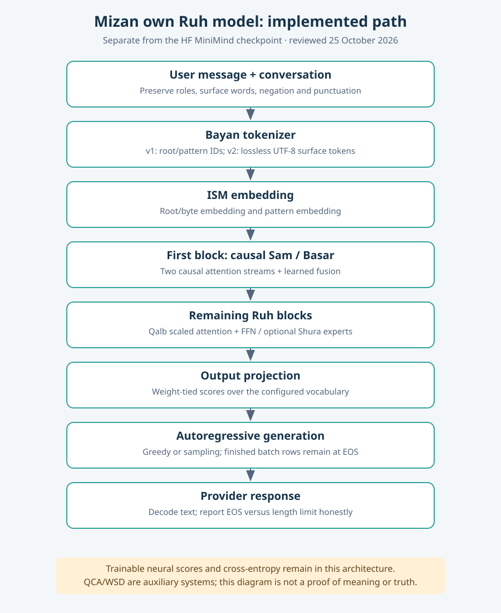
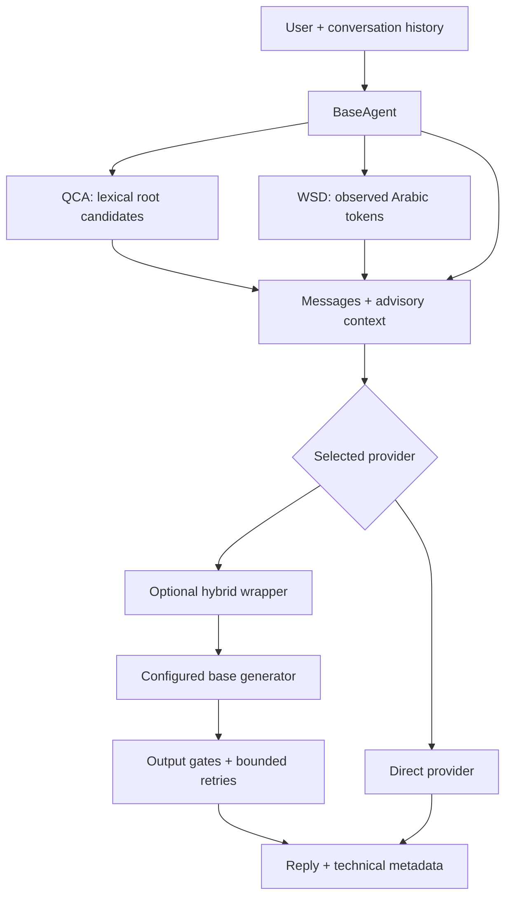
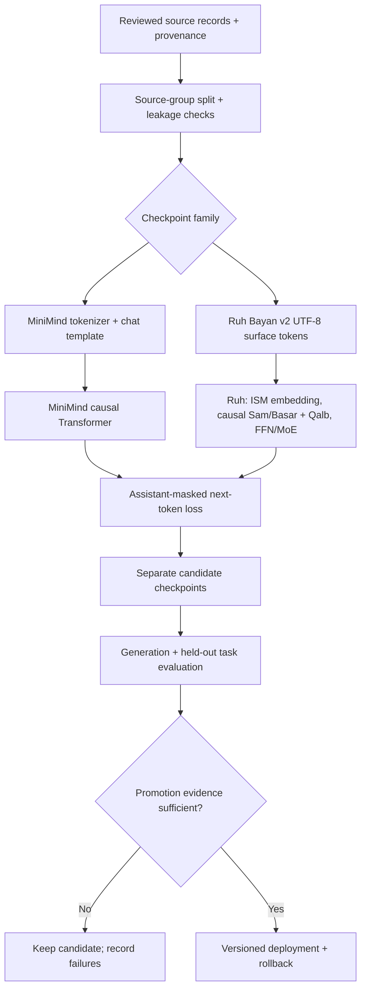

# Actual runtime and training boundaries

> Dated record (25 October 2026). It describes the code as it was then; the current architecture is in [architecture.md](architecture.md) and its [diagrams](diagrams/README.md).

The arrows below describe implemented code paths, not claims about consciousness
or universal semantic understanding. QCA and WSD supply auxiliary data; the
selected generator produces reply tokens. The hybrid path checks declared output
contracts, not whether arbitrary propositions are true.

The two tokenizer/weight families are incompatible. Sharing a JSONL conversation
format does not permit swapping their token IDs or state dictionaries. No dataset
was generated, new checkpoint trained or candidate promoted during this repair.

For `hi`, the observed trace is: user text → no Arabic WSD occurrence → selected
MiniMind worker serializes the exact training chat template → original checkpoint
generates tokens → adapter reads `response`, usage and finish status → UI receives
text. The raw checkpoint answered `فَأَنتَ` in the CPU probe. No greeting template
was inserted to hide this failure. In hybrid mode an EOS reply can pass technical
gates while remaining irrelevant: technical completion is not semantic correctness.
