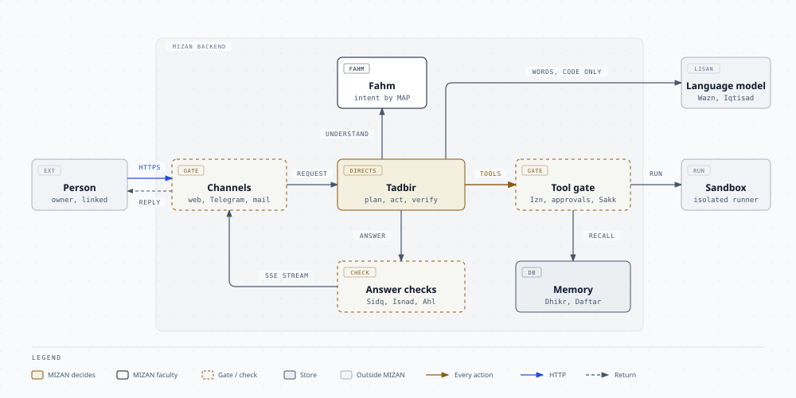
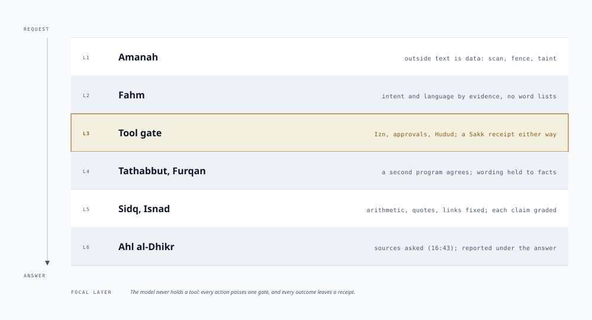
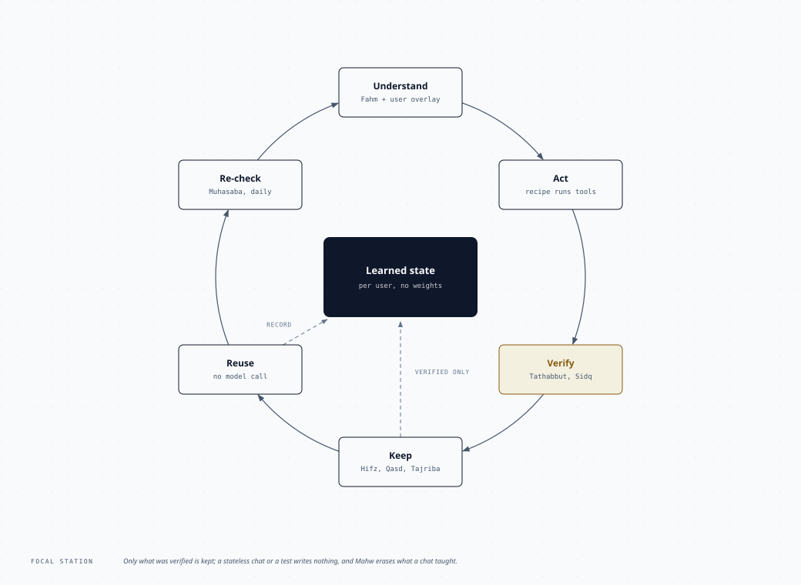

# MIZAN architecture

The current architecture, drawn from the code at commit `5cc11dc` (28 October 2026). Every claim below names its module. To check a box against its code, use the [interactive diagrams](diagrams/README.md): each node links to its source lines.

## The principle: MIZAN directs, the language model speaks

MIZAN's own faculties do the understanding, the acting and the checking. The language model is **Lisan**, the language faculty: it is asked to write a program, map unfamiliar wording onto MIZAN's actions, or word an answer from facts MIZAN already holds. In the default orchestration mode (`MIZAN_ORCHESTRATION=mizan`) the model never chooses or calls a tool. Quran and hadith text, and computed results, never come from the model.

<picture>
  <source media="(prefers-color-scheme: dark)" srcset="diagrams/overview-dark.svg">
  
</picture>

Interactive version, with every component linked to its source: [`diagrams/runtime.html`](diagrams/runtime.html).

## One request, end to end

[`diagrams/chat-turn.html`](diagrams/chat-turn.html) shows this as a sequence.

1. **Entry** (`backend/api/main.py`): `POST /api/chat/stream`.
   - `credentials_first` answers 401 before the body is read.
   - Wali limits chat messages to 30 a minute per user.
   - The run is bound to the chat's approval context, its time zone and its images (`basar.bind`).
   - Telegram, email and WhatsApp messages from linked accounts run the same turn through `_bab_turn`, under deferred approvals.
2. **The run** (`backend/agents/base.py`, `BaseAgent.execute`).
   - Each request runs on its own copy of the agent (`_run_copy`), so runs never queue behind each other.
   - **Amanah** scans pasted text for instructions aimed at the AI. If it finds any, the answer streams only once it is clean.
   - A request for a countable form (**Nazm**) is likewise held until its form is checked.
3. **Understanding** (`backend/tadbir/fahm.py`, `qasd.py`, `lughah.py`, `backend/core/tamyiz.py`).
   - Language and intent are posteriors of weighted naive Bayes models.
   - Smoothing, weights and a length exponent are fitted by grouped leave-one-out; the earlier messages of the chat are the prior.
   - Fahm takes the most probable buildable recipe only when its family is decisive (P > ½).
4. **Planning and action** (`backend/tadbir/engine.py`, `Tadbir.handle`).
   - A recognised request becomes a plan of steps. **Majlis** gives each part to the best agent (Thompson sampling over Beta posteriors per agent and intent).
   - Each step that acts calls a tool through `_execute_tool_safe`.
   - Unfamiliar wording may be mapped by Lisan into MIZAN's steps, which MIZAN validates against each tool's schema before acting.
5. **The tool gate** (`_execute_tool_safe` → `_execute_tool_checked`).
   - Izn permissions, the chat's approval mode (`backend/security/approvals.py`) and Amanah taint are checked.
   - Programs on a project or page run under **Hudud**'s write limits.
   - Code runs only in the isolated runner (`backend/workspace/execution.py`, no local shell).
   - A **Sakk** receipt is written whatever the outcome (`backend/security/sakk.py`).
6. **Verification.**
   - **Tathabbut** asks Lisan for an independent program and requires the same printed numbers.
   - **Furqan** rejects wording that adds numbers or drops a tool's warning.
   - **Hifz** keeps only checked programs and re-runs them later with no model call.
7. **Words only.** When Fahm recognises no action, `Tadbir.handle` returns nothing, and the agent answers in words with no tools.
8. **Answer checks** (for answers MIZAN did not verify).
   - **Sidq** corrects wrong arithmetic, restores altered Quran and hadith quotes from the source, removes fabricated actions and citations, and drops dead links.
   - **Isnad** grades every claim: sahih, hasan, da'if or mawdu'.
   - **Ahl al-Dhikr** asks the user's settled knowledge, Wikipedia and web search about factual claims, judged by a multilingual NLI model, and reports what it found under the answer, never inside it.
9. **Streaming.** SSE events in order: `status`, `todo`, `chat_stream`, then `chat_complete` with the answer, usage, Isnad grades, Sidq changes and receipts.

<picture>
  <source media="(prefers-color-scheme: dark)" srcset="diagrams/trust-layers-dark.svg">
  
</picture>

## Approvals

[`diagrams/approval.html`](diagrams/approval.html) shows the lifecycle of a changing action.

- **Modes.** A chat runs in one of four approval modes:
  - `auto`: nothing is asked;
  - `auto_edits`: execute tools are asked;
  - `ask`: every change is asked;
  - `plan`: changes are refused.
- **Asked in the chat.** An action that needs a person is shown as a card in the live chat. It is decided within 10 minutes, or it is declined.
- **Held when no one is watching.** Watchers, schedules, triggers, the queue and channel messages run unattended. Their changing actions are held in `held_actions.db` with their exact parameters and SHA-256 for up to 24 hours, and decided once at `/api/chat/held/{id}`.
- **Always asked.** `shahid_submit` is asked in every mode.

Approvals are in-process futures, so the backend runs as one uvicorn worker.

## Learning without weights

[`diagrams/learning.html`](diagrams/learning.html) shows where each kind of learning is kept.

<picture>
  <source media="(prefers-color-scheme: dark)" srcset="diagrams/learning-loop-dark.svg">
  
</picture>

What is learned, and where it is kept:

| Kept | Learned from | Module | Stored in |
| --- | --- | --- | --- |
| How a user words a request | A verified result whose wording Lisan or the chat had to place | `qasd.learn`, `taallum.learn` | Learned state, per user |
| Checked programs | Runs that Tathabbut checked | `hifz` | Learned state, per user |
| Repair lessons | A failing program that a fix made run | `tajriba` | Learned state, per user |
| Settled sentences | Sources that support a claim | `ahl_dhikr.keep` | Learned state, per user |
| Agent choice | Each verified outcome | `majlis` | Beta posterior per agent and intent |
| Instruction versions | Paired results | `tajdid` | `harness.db`; a challenger replaces the incumbent only when the paired e-value reaches 1/α_k |
| Model choice | Each attempt | `wazn` | `harness.db`; cheapest ready model first, one step stronger per failure |
| Memory strength | Writes and recalls | `memory/tadhkir.py` | FSRS stability and difficulty in the `memories` table |

Learned state is the adaptive store, in the same SQLite file as the agent's memory.

- **Stateless runs write nothing.** `memory/stateless.py` stops every learned-state write, cross-chat recall and training capture. It is bound for evaluations, comparisons and chats sent with `stateless: true`.
- **Mahw erases a chat everywhere** (`memory/mahw.py`), including what was learned from its requests, and records a receipt.
- **Muhasaba** re-checks unverified answers daily and posts corrections.
- **Sijill** shows each learning step live.

## Memory

| Store | Module | Holds |
| --- | --- | --- |
| Dhikr | `memory/dhikr.py` | Episodic, semantic and procedural memory; cross-chat recall only of statements that hold more than half of the request's distinctive information; Chroma vectors when `MIZAN_VECTOR_URL` is set |
| Daftar | `memory/daftar.py` | A user's notes, preferences, chat summaries and learned items, with provenance; edit, forget, export and import |
| Masalik, knowledge graph | `memory/masalik.py`, `memory/knowledge_graph.py` | Pathways with spreading activation; entities and relations |
| Session summaries | `reasoning/context_engine.py` | A running summary, so a conversation is not limited by the model's window |

## Evaluation

[`diagrams/imtihan.html`](diagrams/imtihan.html) shows the workflow. **Imtihan** (`backend/imtihan/`) sends the same items to the base model alone and to MIZAN through **Muqabala**, under a stateless binding.

- **Tasks:** 194 in all — 85 questions in 13 blocks, 96 faculty items, 10 agentic tasks and 3 games.
- **Scoring:** by rule, with no model judging.
- **Report:**
  - Wilson intervals, pass^k, ECE and Brier;
  - an index weighted agents 30, coding 20, reasoning 20 and general 30;
  - the **Quwa** profile of ten cognitive faculties.

**The human panel** answers the same text items through invite links, and each arm's percentile is the share of the panel it outperforms. A published run becomes a public scorecard with a Sakk receipt.

## Deployment

| Part | Where |
| --- | --- |
| Backend | FastAPI under uvicorn, one worker, data in `$MIZAN_DATA_DIR` (`/data/mizan` in Docker) |
| Frontend | React 19 PWA behind Nginx (`docker-compose.prod.yml`: nginx, backend, frontend, certbot; optional ollama and chroma) |
| Runner | A separate host that runs code, server sessions and the browser in hardened containers, with an egress proxy ([runner-setup.md](runner-setup.md)) |
| Providers | Anthropic, OpenAI, OpenRouter, Ollama or the local Ruh model; every paid call admitted by **Iqtisad** before it is sent |

## The seven-layer QCA map

The packages follow the Quranic Cognitive Architecture named in [CLAUDE.md](../CLAUDE.md):

| Layers | Package | Role |
| --- | --- | --- |
| 1–2 | `perception/` | Senses: voice (Sama'), images (Basar) |
| 3 | `qca/` | Cognitive integration, roots, certainty (Yaqin) |
| 4 | `memory/` | Dhikr, Daftar, Tadhkir, Masalik, Mahw |
| 5 | `reasoning/` | Context engine, planner, causal engine |
| 6 | `agents/` | `BaseAgent`, specialized agents, Nafs levels |
| 7 | `core/` | Principles and faculties (Qalb, Fu'ad, Lubb, Basira, Hawa, Hikmah), Tamyiz, adaptive estimators |

`tadbir/` sits across the layers as the orchestration that uses them. [quranic_human_model.md](quranic_human_model.md) explains the al-Insān model the faculties follow.
